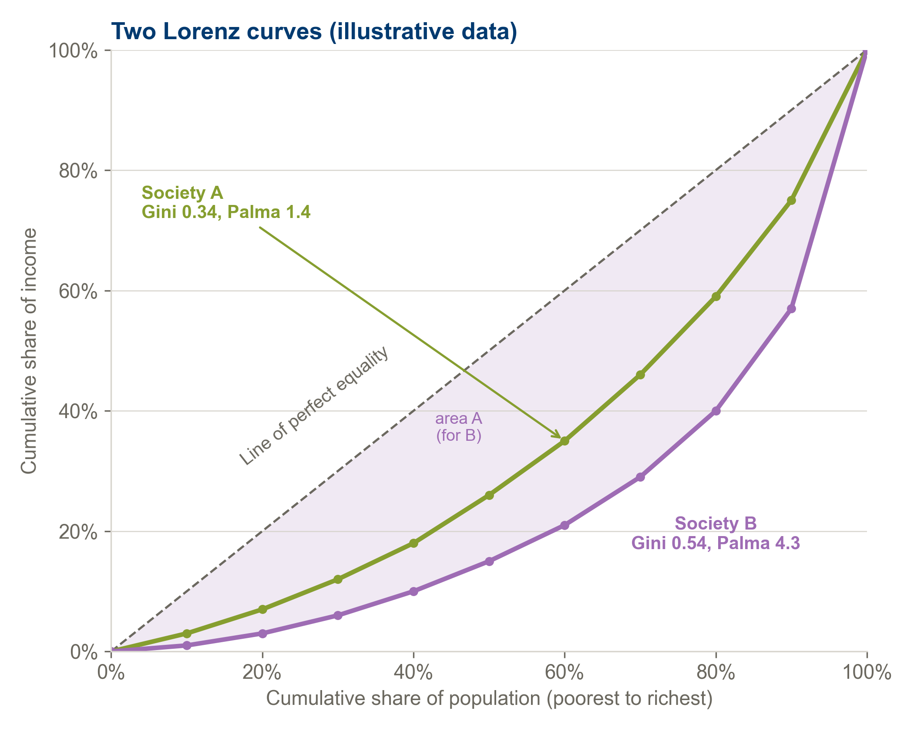

## Dimensions and Measures

### Across dimensions and spaces

Two further distinctions help to sort out what a given number tells us.

| Distinction | Meaning |
|---|---|
| **Vertical inequality** | Inequality among individuals or households, for example between the richest and poorest 10% |
| **Horizontal inequality** | Inequality among groups defined by identity, such as ethnicity, religion, gender, region, or age (Stewart 2005) |
| **Absolute inequality** | The size of the gap between groups, measured in money (for example, dollars) |
| **Relative inequality** | The proportional difference between groups, measured as ratios or shares |

Vertical inequality tells us about the overall distribution. Horizontal inequality makes structural exclusion visible: it matters for social cohesion and conflict whether poverty is spread across society or concentrated in one ethnic group or region (Stewart 2005).

The absolute versus relative distinction will become central in chapter 2. A simple example shows why: a 10% increase on an income of 1,000 dollars is 100 dollars. A 10% increase on an income of 1,000,000 dollars is 100,000 dollars. In relative terms, both grew equally. In absolute terms, the gap widened by 99,900 dollars.

### The Gini coefficient

The most widely used measure of inequality is the Gini coefficient. It is based on the **Lorenz curve**, which plots the cumulative share of the population (from poorest to richest) against their cumulative share of income. If everyone had the same income, the curve would follow the diagonal line of perfect equality.

{#fig-lorenz}

The Gini coefficient is the area between the line of perfect equality and the Lorenz curve (area A), divided by the whole area under the diagonal (A + B). It ranges from 0 (everyone has the same) to 1 (one person has everything).

The Gini is useful, but it has well-known limits (Hickel 2016; Trapeznikova 2019):

- **It is a relative measure.** If all incomes grow by 10%, the Gini stays the same, even though the absolute gap between rich and poor grows.
- **It depends on what is measured.** Values differ for wages, market income, disposable income (after taxes and transfers), consumption, and wealth. Wealth Ginis are typically much higher than income Ginis.
- **It is over-sensitive to the middle** and captures changes at the very top and the very bottom poorly, because it is a calculation of an area.

### The Palma ratio

The **Palma ratio** compares the income share of the richest 10% with that of the poorest 40%. It builds on the observation that the share of the middle classes (deciles 5 to 9) tends to be fairly stable across countries, so that most differences between countries come from the tails. In @fig-lorenz, the richest 10% in society B earn 4.3 times as much as the poorest 40% together. The Palma is easy to communicate and responds to what happens at the top and bottom.

::: {.callout-tip}
## Good practice

No single number captures inequality. Complement the Gini with an absolute measure or the Palma ratio, and say clearly whether you measure income or wealth, before or after taxes, and within or between countries.
:::

### Check your understanding {.unnumbered .unlisted}

```{r}
#| results: asis
exams2forms::exams2forms(c("quiz/q1-3a.Rmd", "quiz/q1-3b.Rmd", "quiz/q1-3c.Rmd"), n = 1)
```

::: {.callout-tip collapse="true"}
## Reflect

- Look up the Gini coefficient of your country on the [World Inequality Database](https://wid.world/). Is it for income or wealth? Before or after taxes?
- Why might a government prefer to report a Gini coefficient rather than the absolute income gap?
:::
