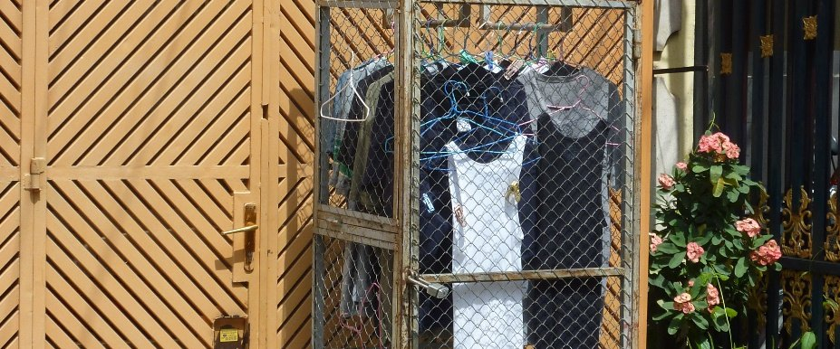

{.chapter-header .no-lightbox fig-alt="Clothes for sale in a locked wire cage on a street, in front of a closed wooden gate."}

::: {.header-credit}
Photo: Christoph Bader, [CC BY-NC-SA 4.0](https://creativecommons.org/licenses/by-nc-sa/4.0/).
:::

The word "inequality" is used loosely: sometimes it means poverty, sometimes unfairness, sometimes the gap between the rich and everyone else. But inequality always implies a comparison: between individuals, groups, regions, or countries, and with respect to something. This chapter sorts out the concepts, shows how inequality is measured, and asks how we can analyse where it comes from. It ends with the question that frames the whole module: which differences do we consider justified, and why?










