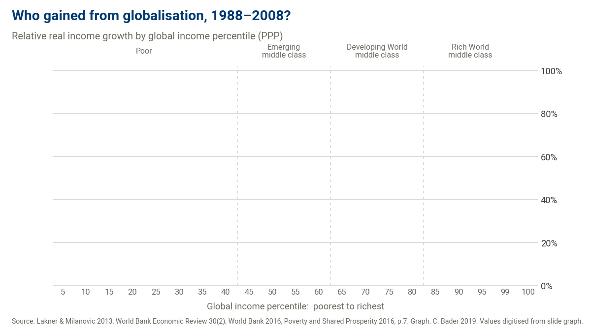

## Story One: The Elephant Curve

One of the most famous graphs in inequality research shows how the incomes of people across the global income distribution grew between 1988 (just before the fall of the Berlin Wall) and 2008 (the global financial crisis). The horizontal axis ranks all people in the world from the poorest (left) to the richest (right). The vertical axis shows the growth of their real income, adjusted for purchasing power, over these 20 years.

{#fig-elephant-relative}

Because of its shape, the graph became known as the **elephant curve**.

::: {.callout-note}
## Before reading on

Look at the curve for one minute. Who gained most from globalisation between 1988 and 2008? Who gained least?
:::

Two points stand out:

- **Point A**, around the middle of the distribution, marks the largest relative gains, of 70 to 80%. These are mostly people in the emerging middle classes of Asia, above all in China.
- **Point B**, around the 80th percentile, marks almost no gains. These are mostly lower middle classes in Western Europe and North America.

The very top of the distribution also gained strongly, and the very poorest gained relatively little.

The story this graph seems to tell is a story of progress and convergence: many of the poorer people of the world (on the left) gained more, in percentage terms, than most of the rich (on the right). Global inequality between countries has fallen, and extreme poverty has declined.

It also helps explain political tensions in rich countries: while hundreds of millions in Asia moved up, many in the lower middle classes of the Global North felt left behind. Populist backlashes and disillusionment with globalisation partly feed on this experience.

### Check your understanding {.unnumbered .unlisted}

```{r}
#| results: asis
exams2forms::exams2forms(c("quiz/q2-2a.Rmd", "quiz/q2-2b.Rmd"), n = 1)
```

::: {.callout-tip collapse="true"}
## Reflect

- Where on the curve would you place yourself, your parents, and your grandparents?
- The curve shows *relative* growth. What would you need to know to judge whether the gains were fairly shared?
:::
