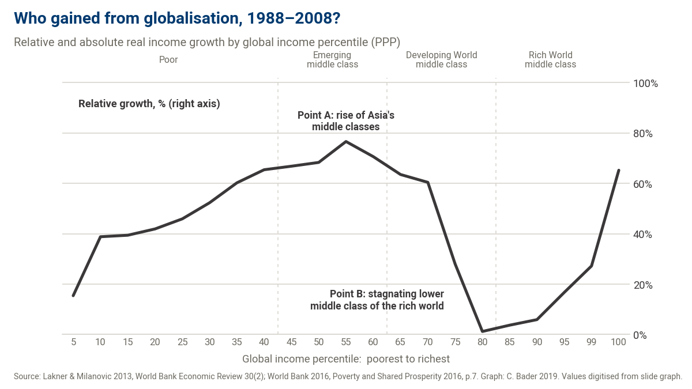

## Story Two: The Absolute View

Now look at the same data from a different angle. The red line shows not the *percentage* growth but the growth of income in *dollars* for each percentile.

{#fig-elephant-absolute}

The picture changes dramatically. In absolute terms, the lowest 90% of the world population saw only small income gains, while the richest gained far more than anyone else. A large percentage increase on a very small income is still a small amount of money. Relative convergence can coexist with absolute divergence.

If global cooperation and growth produce gains, the question of how these gains are shared is unavoidable. From the absolute perspective, the story is not one of convergence, but of a world drifting apart.

### Which poverty line?

The same tension appears in debates on poverty. In 2019, the anthropologist Jason Hickel published an article with the title "Bill Gates says poverty is decreasing. He couldn't be more wrong." The argument raises three questions you can ask of any poverty statistic:

- **The China effect.** A large part of the global decline in extreme poverty happened in one country, China, under a development model far from the free-market recipe usually credited with it.
- **Which poverty line?** The World Bank's international extreme poverty line (USD 1.90 a day until 2022, USD 2.15 until 2025, now USD 3.00 in 2021 prices) is very low. The World Bank also publishes higher lines for lower and upper middle-income countries (USD 4.20 and USD 8.30 a day), and some researchers argue for lines of USD 10 or more to capture a decent life. With higher lines, the number of poor people has fallen much less, or has even risen.
- **Relative or absolute?** Has the share of poor people fallen, or their number? Measured against what is needed to live a decent life where people live?

### What do newer data say?

Gradín (2024) revisits global inequality trends from 1980 to 2020. He confirms that global inequality declined in relative terms since about 2000, mainly because of strong growth in China, India, and other emerging economies. In absolute terms, however, inequality kept rising.

::: {.callout-important}
## Key takeaways of chapter 2 so far

- In terms of dollar distances between people (absolute inequality), inequality has unequivocally increased, both between and within countries.
- Global inequality in relative terms has declined since about 2000, mainly due to strong growth in China, India, and other emerging economies.
- The exceptions are at the extremes of the distribution: stagnation among the very poor and rising concentration among the very rich.
:::

### Check your understanding {.unnumbered .unlisted}

```{r}
#| results: asis
exams2forms::exams2forms(c("quiz/q2-3a.Rmd", "quiz/q2-3b.Rmd"), n = 1)
```

::: {.callout-tip collapse="true"}
## Reflect

- Which of the two stories do you find more convincing now? Has your view changed since section 2.1?
- If you were a government spokesperson in a fast-growing economy, which graph would you show? And if you were a trade union representative?
:::
