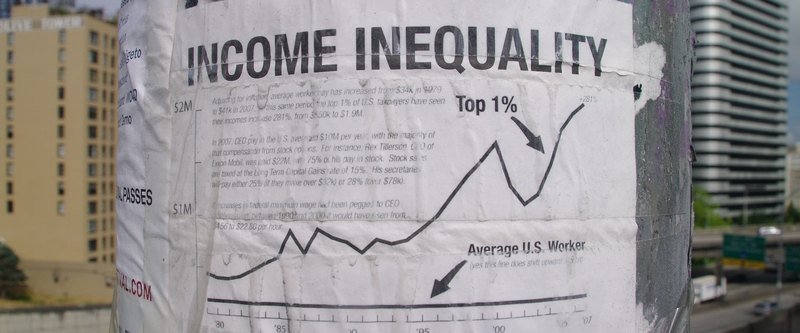

{.chapter-header .no-lightbox fig-alt="Poster on a lamp post titled Income Inequality, showing income of the top 1% rising far above the average US worker."}

::: {.header-credit}
Photo: ["Income Inequality"](https://flickr.com/photos/27305863@N07/6023390537) by mSeattle, [CC BY 2.0](https://creativecommons.org/licenses/by/2.0/), cropped.
:::

We have analysed what inequality is, how it has developed, and why it is rising. Now comes the critical question: what can be done? If inequality is produced by rules and institutions, it can be reduced by changing them. Addressing inequality requires more than redistribution after the fact. It means rethinking how value is created, who owns productive assets, and how power is shared. This chapter presents five directions, building on the analytical lens of chapter 3, and ends by asking where you stand.










