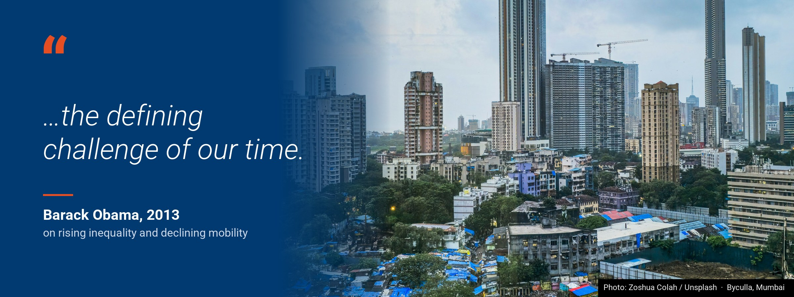

# Inequality: A Tale of Two Stories. Open e-learning module, CDE, University of Bern

An open, self-paced module on concepts, trends, causes, and the politics of inequality, by the [Centre for Development and Environment (CDE)](https://www.cde.unibe.ch/). It also serves as preparation and follow-up for the inequality session of the CDE Online International Winter School.

**Online module:** https://cdeteaching.github.io/inequality/ (once published)

## Sources

The module was built (2026-11-16) from three sources:

- the learning website [*A defining issue of our time*](https://sites.google.com/view/inequalitysummerschool21/home) (Sabin Bieri and Christoph Bader, CDE Summer School 2021, updated 2023): text, reading, preparatory exercise, additional material
- the slide deck *WinterSchool26_Inequality_Bader.pdf* (Winter School session 7, 27 January 2026): storyline and interactive elements
- the SfS1 lecture *A world drifting apart* (2025) and its speaker notes in the Obsidian vault, plus vault notes on Kapeller (2026), Sandel, and Piketty: explanations, examples, exercise questions

## Structure

| Path | Content |
|---|---|
| `index.qmd` | Welcome page, two ways to use the module, learning outcomes |
| `01_...` to `04_...` | Chapters. `N_chapter.qmd` is the chapter page and includes one `N-M_*.qmd` file per section |
| `0N_.../quiz/*.Rmd` | Quiz items (R/exams format), rendered per section with `exams2forms` |
| `0N_.../images/` | Figures per chapter |
| `winter-school/session.qmd` | Session plan for the live session (preparation, 90-minute plan, follow-up) |
| `resources.qmd` | Additional material from the 2021/2023 site, by chapter |
| `references.qmd` | Reference list (not yet a `.bib`) |

Every section ends with **Check your understanding** (quiz) and **Reflect** (open questions). Exercises with a "What a good answer covers" checklist sit in 2.4 (My inequality graph) and 3.5 (Reasons in your country). Nothing is graded.

## Figures

- `images/banner.jpg`: header banner. Photo by [Zoshua Colah](https://unsplash.com/@zoshuacolah) on [Unsplash](https://unsplash.com/photos/n58coLztH9E) (Byculla, Mumbai), [Unsplash License](https://unsplash.com/license), not covered by CC BY-NC-SA. Quote: Obama, remarks on economic mobility, 4 December 2013 ("I believe this is the defining challenge of our time"). Rebuild with `images/make_banner.py` (Pillow, Roboto, CDE navy/orange).
- `0N_.../images/header.jpg`: chapter header images, taken from the chapter title slides of *WinterSchool26_Inequality_Bader.pptx* (slides 5, 16, 29, 40) and cropped to 12:5. Also used as chapter cards on the welcome page. Ch. 2: "Janus-Chicken" by David Goehring, CC BY 2.0. Ch. 4: "Income Inequality" by mSeattle, CC BY 2.0. Ch. 1 (clothes cage): own photo, Christoph Bader, CC BY-NC-SA 4.0. Ch. 3 ("We are the 99%" sign): CC-licensed (photographer not recorded).
- `01_.../images/lorenz-gini-palma.png`: own figure, illustrative data; rebuild with `lorenz-gini-palma.py` (matplotlib, CDE palette).
- `02_.../images/elephant_absolute_*`: own charts (C. Bader 2019, rebuilt 2026 with the `cde-charts` skill). Values digitised from the original slide, approximate; see `elephant_absolute.csv`. Source data: Lakner and Milanovic (2016), World Bank (2016).

## Rendering

Built with Quarto (book) and knitr. Requires R with the packages `exams` and `exams2forms`. Render from RStudio with **Render Book**, or with `quarto render` in the repo folder; output goes to `docs/` for GitHub Pages. The site has **not been rendered yet**.

To add a quiz item, copy an existing `.Rmd` in the chapter's `quiz/` folder and add it to the `exams2forms(...)` call at the end of the section file. Paths are relative to the chapter folder.

## License

Unless otherwise indicated, all materials are licensed under [CC BY-NC-SA 4.0](https://creativecommons.org/licenses/by-nc-sa/4.0/).
