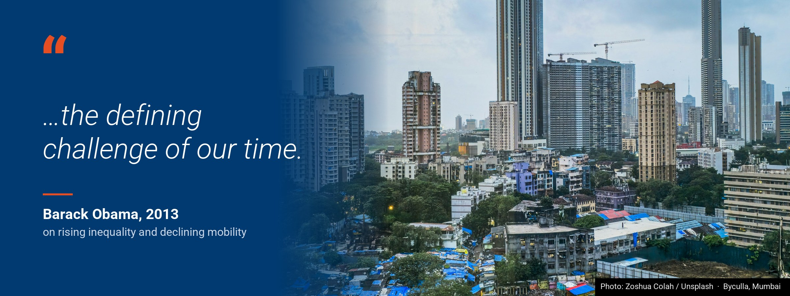
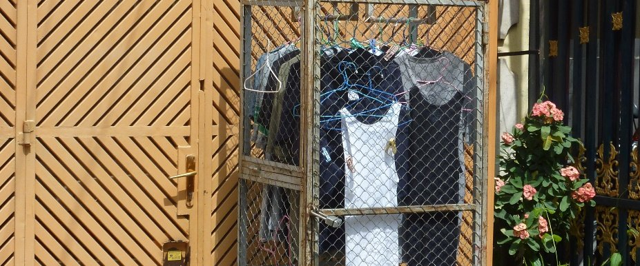
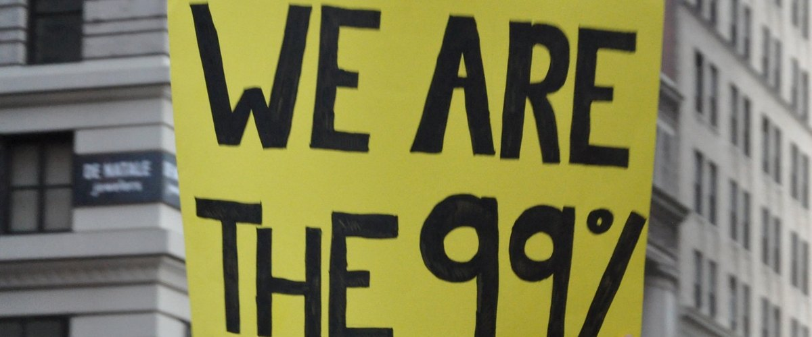
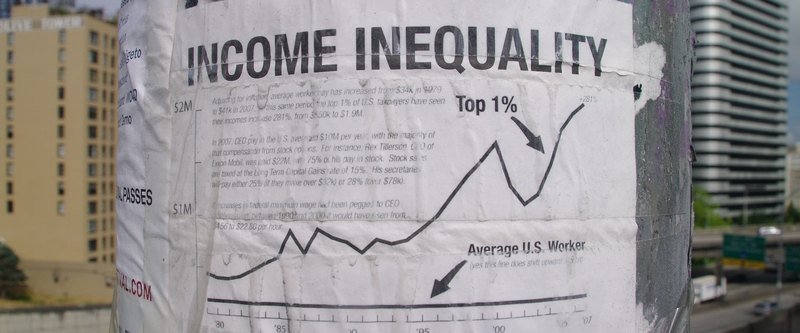

# Welcome {.unnumbered}

{fig-alt="Quote by Barack Obama (2013): '...the defining challenge of our time.' Next to it, a photo of Byculla, Mumbai, where high-rise towers stand above informal settlements with blue tarpaulin roofs." width="100%"}

In 2013, Barack Obama called rising inequality "the defining challenge of our time." Since then, the topic has moved from the margins of economics to the centre of public debate. Yet people who agree that inequality matters often mean very different things by it, read the same data in opposite ways, and propose opposite remedies.

This module takes that disagreement seriously. Its title, *a tale of two stories*, refers to the two narratives that dominate the debate: one of progress, in which global growth has lifted billions out of extreme poverty and countries have converged, and one of polarisation, in which societies drift apart and the gains of growth flow to the top. Both stories rest on empirical evidence. Learning to see which assumptions, measures, and theories of justice sit behind each story is the core skill this module trains.

The module accompanies the inequality session of the **CDE Online International Bachelor and Master Winter School**. It is an open educational resource by the [Centre for Development and Environment (CDE)](https://www.cde.unibe.ch/), University of Bern, so anyone interested can use it. No prior knowledge of economics is required.

## Learning outcomes

After completing this module, you can:

- distinguish key concepts of inequality (outcome and opportunity, vertical and horizontal, absolute and relative, individual and structural) and explain why the choice of concept is never neutral
- explain how the Gini coefficient and the Palma ratio are constructed and name their limits
- interpret the "elephant curve" in relative and absolute terms and explain why both stories about global inequality can be told with the same data
- compare conventional explanations of rising inequality (technological change, globalisation) with structural explanations (weakening redistributive state, erosion of countervailing powers, financialisation)
- evaluate policy options ranging from redistribution to pre-distribution and universal basic services, and position yourself in the debate

## Structure

::: {.grid .chapter-cards}

::: {.g-col-12 .g-col-md-6}
[{.no-lightbox fig-alt=""}](01_whats-in-a-word/1_chapter.qmd)

**[1 Inequality: What's in a word?](01_whats-in-a-word/1_chapter.qmd)**

What do we mean by inequality, and how can we measure and analyse it?
:::

::: {.g-col-12 .g-col-md-6}
[{.no-lightbox fig-alt=""}](02_tale-of-two-stories/2_chapter.qmd)

**[2 A tale of two stories](02_tale-of-two-stories/2_chapter.qmd)**

What has happened to global inequality since the fall of the Berlin Wall?
:::

::: {.g-col-12 .g-col-md-6}
[{.no-lightbox fig-alt=""}](03_why-rising/3_chapter.qmd)

**[3 Why is inequality rising?](03_why-rising/3_chapter.qmd)**

Which forces drive inequality, and is it a natural market outcome?
:::

::: {.g-col-12 .g-col-md-6}
[{.no-lightbox fig-alt=""}](04_way-forward/4_chapter.qmd)

**[4 The way forward](04_way-forward/4_chapter.qmd)**

What can be done, and where do you stand?
:::

:::

## Acknowledgements, license and citation

This module builds on the learning website *A defining issue of our time* (2021, updated 2023), written by Sabin Bieri and Christoph Bader for the CDE Online International Summer School, and on the CDE Policy Brief *Inequality: What's in a word?* (Lannen 2019).

Unless otherwise indicated, all materials are licensed under [CC BY-NC-SA 4.0](https://creativecommons.org/licenses/by-nc-sa/4.0/). The quizzes are built with the open-source R package [exams](https://www.r-exams.org/).

Bader, C. (2027). *Inequality: A Tale of Two Stories. Concepts, trends, causes, and the politics of inequality.* Centre for Development and Environment, University of Bern. https://cdeteaching.github.io/inequality/
